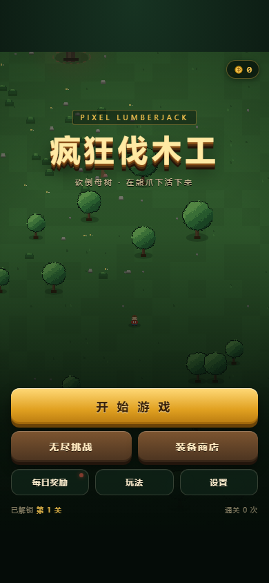
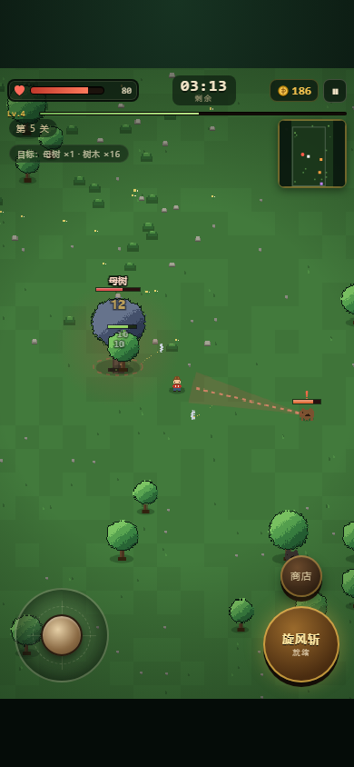
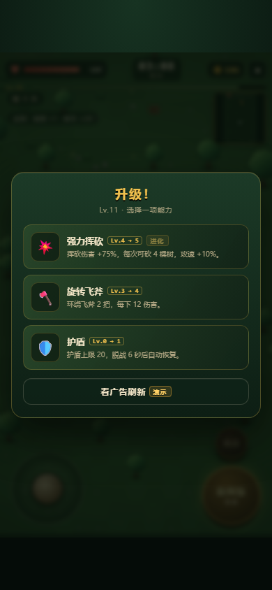

# 疯狂伐木工 · 可玩原型

基于《疯狂伐木工 GDD V1.0》实现的 2D 像素风伐木 / 生存 / 肉鸽闯关原型。
纯前端、零依赖、离线可跑，不需要 Cocos Creator，也不需要 `npm install`。



## 快速开始

- **直接双击 `index.html`**（Chrome / Edge 均可，`file://` 下即可运行）。
- 或者在本目录起一个静态服务：`python -m http.server 8000`，打开 <http://localhost:8000>。

推荐用手机尺寸查看：Chrome DevTools 切成 390×844 或 360×640。

| 战斗 | 升级三选一 |
|---|---|
|  |  |

| 装备商店 | 结算 |
|---|---|
|  |  |

## 操作

| 操作 | 键鼠 | 触屏 |
|---|---|---|
| 移动 | `WASD` / 方向键 | 左下虚拟摇杆 |
| 普通攻击 | 自动（靠近目标） | 自动 |
| 旋风斩 | `空格` / `J` | 右下技能按钮 |
| 局内商店 | `E` | 「商店」按钮 |
| 暂停 | `Esc` / `P` | 右上暂停按钮 |

角色靠近树木会自动砍树；附近没有树时攻击熊；被熊贴身时会优先反击。砍倒所有**母树**并把地图树木清空即通关。

## 已实现内容（对照 GDD）

| GDD 章节 | 实现情况 |
|---|---|
| 1 核心循环 | ✅ 进入关卡 → 砍树 → 升级 → 打熊 → 清母树 → 清场 → 结算 → 永久强化 |
| 2 核心规则 | ✅ 摇杆、自动攻击、旋风斩主动技能、限时、胜负判定、广告复活/续时共享 2 次 |
| 3 玩家与战斗 | ✅ 生命/移速/攻击/攻速/暴击、受伤无敌、脱战回复、熊的巡逻/追击/蓄力/冲锋/眩晕/死亡 |
| 4 树木与母树 | ✅ 四阶段生长、母树繁殖、树木扩散、密度加成、数量上限、母树小地图标记 |
| 5 熊与熊窝 | ✅ 棕熊/黑熊/巨型熊/熊王、熊窝刷熊、边缘刷熊（无尽）、冲锋撞树、撞巨树/母树眩晕 |
| 6 装备与成长 | ✅ 主武器 + 护甲 + 鞋子 + 3 种辅助装备、永久购买/强化、局内三选一技能、5 级进化 |
| 7 双商店与经济 | ✅ 局内金币买道具、永久金币买装备、失败保留 50% / 广告 100%、通关奖励 |
| 8 地图与难度 | ✅ 随关卡扩大的瓦片地图、镜头跟随、小地图、熊王 16 关后出现、连败 3 次给缓冲 |
| 9 广告变现 | ✅ 玩家主动触发；复活/续时/刷新技能/保留金币/双倍金币/每日奖励；**广告为模拟播放** |
| 10 UI 与美术 | ✅ 大厅/战斗/结算/商店/升级/暂停；代码生成像素素材（32×32 基准、最近邻缩放）；合成音效 |
| 11 技术架构 | 🟡 浏览器版按相同职责拆分模块；Cocos 版模块映射见下文 |
| 12 里程碑 | ✅ 可完整打一局；战斗、成长、商店、存档、广告占位均可用 |
| 13 待验证问题 | 🟡 数值已用自动玩家跑过 1–20 关，仍需真人试玩微调 |

## 玩法与系统

### 树木与母树

- 树苗 → 小树 → 大树 → 巨树，血量与收益逐级提升（GDD 表格数值）。
- 母树存活时：每 5.5 秒在身边生成树苗；大树及以上会向空地扩散，密集树林扩散更快，但有总量上限。
- 母树倒下后停止生成新树，但现有树木仍会生长；清空全部树木才算通关。
- 母树会在小地图上以红点闪烁，并在屏幕边缘显示红色指示箭头。

### 熊与熊窝

- 棕熊 / 黑熊 / 巨型熊 / 熊王，血量、速度、伤害、体型不同。
- 熊会蓄力（红色预警线）后直线冲锋；撞倒小树不产生收益，撞到巨树或母树会眩晕 1.8 秒。
- 熊窝定期刷熊（同时存活数有上限），可被摧毁；后期关卡与无尽模式会从地图边缘刷熊。
- 自动攻击会优先树木，但贴身撕咬的熊会被优先反击，避免“站着被咬无法还手”。

### 技能（三选一，5 级进化）

| 基础技能 | 进化 | 效果 |
|---|---|---|
| 旋转飞斧 | 雷霆飞斧 | 飞斧环绕身体持续切割，进化后 +1 把并带落雷光效 |
| 强力挥砍 | 伐木风暴 | 挥砍伤害提升，3 级起一次砍多棵树，进化后目标 +2、攻速提升 |
| 燃烧弹 | 烈焰森林 | 定期投掷范围燃烧弹，进化后范围扩大并留下火海 |
| 护盾 | 钢铁壁垒 | 可再生护盾，进化后受击对周围反伤 |
| 狂暴 | 极限狂暴 | 攻速/移速提升，击杀叠加狂暴，进化后常驻额外攻速 |

升级时暂停并三选一；技能满 5 级自动进化。可用模拟广告刷新一次选项。

### 永久成长

- 武器 6 把：破旧斧头 → 铁斧 → 钢斧 → 电锯 → 黄金电锯 → 传奇伐木斧；可继续 +1~+10 强化（每级 +2 伤害）。
- 护甲 4 件、鞋子 3 双、辅助装备 3 件（旋转飞斧 / 伐木机器人 / 护盾核心）。
- 永久金币来自结算；失败保留 50%，看广告可保留 100%；通关额外奖励 30 + 关卡数 ×10。
- 存档写入 `localStorage`，键名 `crazy-lumberjack-save-v1`。

### 无尽模式

- 26×40 大地图，计时向上累计，不要求清场。
- 母树会定期重生，熊从地图边缘持续刷新，分数 = 存活时间 + 砍树量 + 击杀 + 母树。
- 死亡结算，保留全部收益。

### 动态难度

- 同一关连续失败 3 次：下一局攻击与生命 +10%；连续 6 次：+20%（最多 2 层）。
- 不会因为玩家不看广告而暗中提高难度。

## 与 GDD 的数值偏差（有意为之，均在 `src/config.js` 可调）

GDD 明确写了“数值均为待测试参数”，首轮自动试玩后做了如下调整，否则单局会超过 10 分钟：

| 项目 | GDD | 当前 | 原因 |
|---|---|---|---|
| 母树生命 | 1000 | 600（`MOTHER_HP_SCALE`） | 保证 3–5 分钟一局 |
| 初始攻击 / 间隔 | 10 / 1.0s | 12 / 0.8s | 提升前期手感 |
| 树木生长时间 | 未定 | 35 / 42 / 50 / 60 秒 | 避免 3 分钟内全图巨树 |
| 棕熊伤害 / 冲锋 | 15 / 30 | 8 / 16 | 玩家只有 100 血，原数值过于致命 |
| 初始树木数量 | 未定 | 12 + 关卡×2 | 控制单局时长 |
| 脱战回复 | 无 | 5 秒后 1.5 HP/s | 没有回复手段时体验太差 |
| 升级回复 | 无 | 每次 +10 HP | 同上 |
| 贴身熊反击 | 树木绝对优先 | 贴身时反击 | 避免被熊贴脸却无法还手 |
| 母树优先级 | 未说明 | 母树优先于普通树 | 让“先砍母树”的策略真正成立 |

## 目录结构

```
crazy-lumberjack/
├── index.html          入口（按顺序加载脚本，无构建）
├── styles.css          UI / HUD / 弹层样式
├── src/
│   ├── config.js       全部数值、关卡、装备、技能配置
│   ├── rng.js          可复现随机数
│   ├── sprites.js      代码生成的像素素材（树/熊/人/熊窝）
│   ├── world.js        纯逻辑模拟层（无 DOM）
│   ├── render.js       Canvas 渲染、镜头、小地图、粒子
│   ├── audio.js        WebAudio 合成音效
│   ├── save.js         localStorage 存档
│   ├── ui.js           大厅/关卡/商店/升级/结算/广告界面
│   └── game.js         状态机、输入、主循环、经济结算
├── tests/
│   ├── sim.test.js     15 项模拟层测试（node tests/sim.test.js）
│   ├── bot.js          自动玩家（平衡性回归）
│   ├── diag.js         多关卡胜率/用时诊断
│   └── harness.js      在 Node 中加载浏览器脚本
├── tools/
│   ├── cdp_shot.js     Chrome CDP 截图 / 执行脚本 / 收集报错
│   ├── ui_click_test.js UI 点击流程回归
│   ├── ui_flow_test.js 局内商店 / 升级 / 无尽模式回归
│   └── final_check.js  清存档 → 选关 → 移动 的端到端冒烟
└── docs/               README 截图
```

## 测试与调参

```bash
node tests/sim.test.js          # 15 项逻辑测试
node tests/diag.js 1,3,5,7,10   # 自动玩家跑指定关卡（每关 3 个种子）
node tests/diag.js 1,5,10,16 101,202
```

自动玩家会：优先推进母树、被熊贴脸时后撤、技能优先拿强力挥砍/飞斧、升级自动选择。
当前基准（每个关卡 3 个种子）：

| 关卡 | 无永久装备 | 铁斧 + 皮甲 | 钢斧 + 锁甲 + 疾风靴 | 传奇 + 板甲 + 辅助全开 |
|---|---|---|---|---|
| 1 | 3/3，72–105s | — | — | — |
| 3 | 3/3，110–131s | — | — | — |
| 5 | 2/3，166–194s | 3/3，126–141s | 3/3，73–83s | — |
| 7 | 0/3 | 1/3 | 3/3 | — |
| 8 | 0/3 | 0/3 | 3/3，101–126s | — |
| 10 | 0/3 | 0/3 | 3/3，166–183s | — |
| 12 | — | — | 3/3，173–215s | 3/3，59–63s |
| 16 | — | — | 0/3 | 3/3，90–121s |
| 20 | — | — | 0/3 | 3/3，97–114s |

也就是说：第 1–5 关可以裸装过，第 7 关开始明显吃装备，第 16 关（熊王）基本需要传奇伐木斧。
这些数字只代表“自动玩家”的下限，真人利用走位、旋风斩和药水会更好。

## 广告说明

当前是单机原型，**所有广告都是模拟播放**（3 秒倒计时 + 进度条），不会请求任何网络或 SDK。
接入微信 / 抖音小游戏时，在 `src/game.js` 的 `showAd` 调用处替换为平台 `createRewardedVideoAd`，
保留“完整观看才发奖、加载失败不扣次数”的逻辑即可。

## 迁移到 Cocos Creator 3.x 的建议

这个原型的逻辑层（`world.js`）不依赖 DOM，可以整体迁移：

- `World` → 若干 Component 共享的纯数据/系统层；`TreeManager`、`BearAI`、`EconomyManager` 等模块按 GDD 拆分。
- 单位换算：当前 1 格 = 24px，1 单位 = 1 格；Cocos 中把 `TILE` 改成世界单位即可，逻辑里的“单位/秒”不用动。
- 渲染：把 `render.js` 的 Canvas 绘制换成 Sprite + 对象池；树木/熊/角色按 y 排序设置 `siblingIndex`。
- 输入：摇杆值直接映射到 `input.x/y`，技能按钮映射 `input.skill`。
- 广告：新增 `AdManager`，把 `showAd` 的模拟倒计时替换为平台激励视频。
- 存档：`SaveManager` 换成平台 `wx.setStorageSync` / `tt.setStorageSync`，字段结构可直接复用。
- 屏幕：设计分辨率 360×640，适配 9:16，`fitHeight` + 左右留边。

## 已知限制 / 下一步

- 广告是模拟的，未接微信/抖音 SDK，也没有真实广告位 ID。
- 美术与音效均为代码生成，正式版应替换为 32×32 像素资源和音频文件。
- 未实现 GDD 中的地图障碍物、独立“精英熊”模板、每日强化材料、Boss 战。
- 熊/角色没有寻路与碰撞体积，只有地图边界约束；树木可穿过。
- 30 关数值只用自动玩家粗调过，仍需要真人试玩（尤其 10 关以后）。
- 未做微信/抖音小游戏包体、分包、性能与真机适配。

## 原文档

`C:\Users\29022\Downloads\疯狂伐木工_GDD_V1.0.docx`
